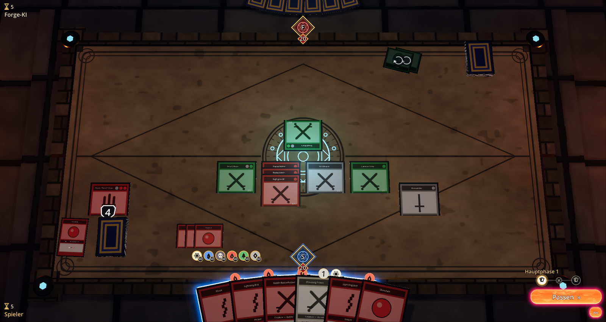
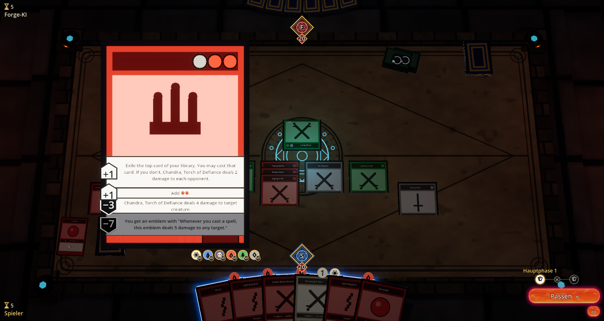
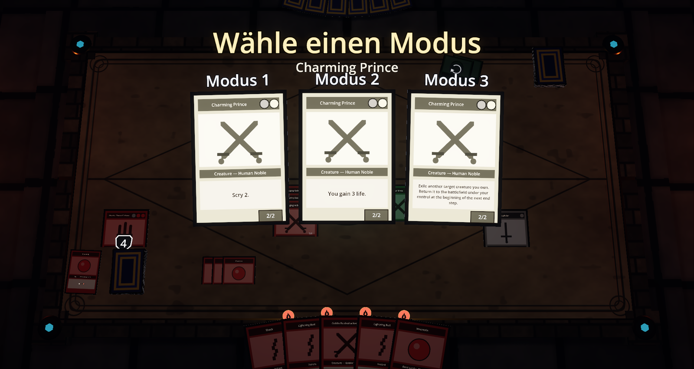
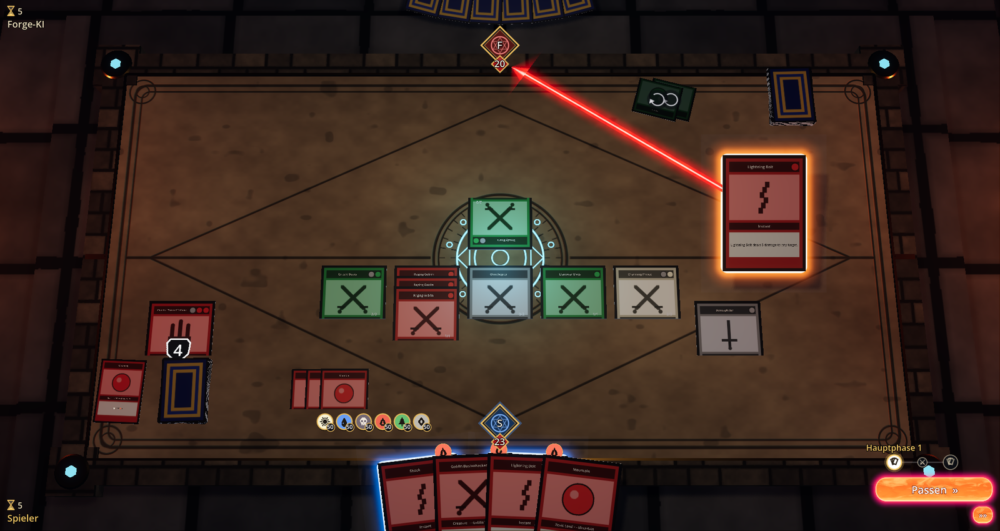
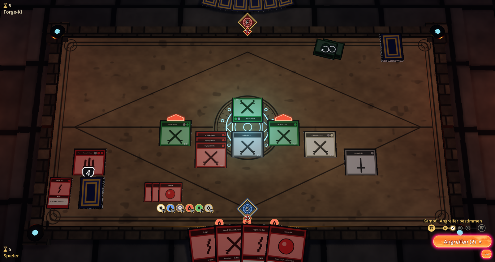

# MTG Clash

**Ein 3D-Spieltisch für die komplette Magic-Regel-Engine von [Forge](https://github.com/Card-Forge/forge)** –
gebaut mit Godot 4.7 und Rust. Jede Entscheidung, die Forge einem Spieler abverlangt, triffst du
direkt am Tisch; die KI spielt nur deinen Gegner. Der Tisch prüft selbst keine Regeln: Er zeigt
den Zustand der Engine und schickt ihr deine Antworten.

> *English:* A 3D table (Godot 4.7 + Rust) for the complete rules engine of Forge. Every decision
> Forge asks of a player is made at the table; the AI only plays the opponent. The Forge
> integration is split into reusable pieces (Java bridge, godot-free Rust crates, NeoForge
> integration) – see [docs/Einbau.md](docs/Einbau.md).



<sub>Alle Bilder sind im Modus „nur eigene Grafik“ entstanden (`CLASH_FREE_ASSETS=1`): selbst
gezeichnete Kartenrahmen, Typsymbole und Manasymbole, keine Kartenbilder.</sub>

## Was der Tisch kann

- **Alles am Tisch entscheiden:** Karten aus der Hand aufs Feld ziehen, Ziele per Pfeil,
  Angreifer und Blocker per Klick, Mana bezahlen (Quellen anklicken oder automatisch), Mulligan,
  Hellsicht, Karten wählen, Reihenfolge von Auslösungen, Modi (auch Spree/Tiered mit Kosten),
  Kicker und andere Zusatzkosten, Farbrad für Farben, Schaden verteilen.
- **Der ganze Spielzustand sichtbar:** Stack als 3D-Stapel mit Zielpfeilen, Friedhof und Exil,
  Kommandozone, Marken als Münzen, angelegte Auren und Ausrüstung, Spielsteine, doppelseitige und
  verdeckte Karten, Monarch/Initiative/Ring, Tag/Nacht, Klassen, Räume, Sagas.
- **Planeswalker wie gewohnt:** Klick öffnet die Karte groß, die Loyalitätsfähigkeiten wählst du
  direkt auf der Karte.
- **Karten aus anderen Zonen** (Rückblende, Commander, Begleiter, Vorbereiten …) erscheinen
  rechts neben der Hand mit den Kosten ihrer Spielweise.
- **Zwei Wege zu Forge:** eigenständig (der Tisch startet Forge als Java-Prozess) oder
  eingebettet in [NeoForge](https://github.com/AdrianLopez98/NeoForge), das seine Partien
  (Standard, Pioneer, Modern, Legacy, Vintage, Pauper, Commander, Draft, Cube) am 3D-Tisch spielen lässt.
- Deutsch und Englisch.

| Planeswalker | Modus wählen |
|---|---|
|  |  |
| **Zauber auf dem Stack mit Zielpfeil** | **Angreifer wählen** |
|  |  |

## Aufbau

| Ordner | Inhalt |
|---|---|
| `godot/` | Godot-Projekt (Hauptszene `table.tscn`) |
| `rust/` | Godot-Erweiterung (gdext): Tisch, HUD, Darstellung |
| `rust/crates/clash-protocol/` | Protokoll-Modell `Decision`/`Choice` + JSON, ohne Godot |
| `rust/crates/clash-forge-client/` | Verbindung zur Brücke (Java-Prozess oder Gastgeber), ohne Godot; Beispiel `autoplay` |
| `forge-bridge/` | Java-Brücke zu Forge: Fassade `ClashBridge`, `TableLauncher`, Forge-Adapter |
| `integrations/neoforge/` | Anbindung an NeoForge: `ClashTable` + Patch für NeoForges Klassen |
| `docs/` | Bedienung (`DOKUMENTATION.md`), Protokoll (`Forge-Schnittstelle.md`), Einbau in andere Projekte (`Einbau.md`), API-Referenz |
| `tools/` | Skripte (Doku, NeoForge-Sync/-Patch/-Test) |

Die Anbindung an Forge lässt sich ohne den Godot-Tisch wiederverwenden – für eigene Oberflächen
und andere Forge-Programme: **[docs/Einbau.md](docs/Einbau.md)**.

## Schnellstart

Voraussetzungen: Godot 4.7, Rust (Edition 2024), Java 17+ und eine Forge-Installation
(Desktop-Version; Ordner mit `res/` und `forge-gui-desktop-*-jar-with-dependencies.jar`).

```sh
FORGE_DIR=/pfad/zu/forge forge-bridge/build.sh   # Java-Brücke
cd rust && cargo build                            # Godot-Erweiterung und Crates
# Godot 4.7 öffnen: godot/project.godot, F5 (FORGE_DIR muss gesetzt sein,
# oder Forge nach forge-bridge/forge/ kopieren)
```

Einrichtung im Detail: [docs/Forge-Schnittstelle.md](docs/Forge-Schnittstelle.md), Abschnitt
„Einrichtung“. Nur eigene Grafik (keine Kartenbilder, keine fremden Symbole):
`CLASH_FREE_ASSETS=1` setzen bzw. Godot mit `-- --free-assets` starten.

## Lizenz

**GPL-3.0** wie Forge – siehe [`LICENSE`](LICENSE).

Nicht im Repo und nicht Teil dieser Lizenz: Forge selbst (Programm-Jar und Kartendatenbank) und
die Kartenbilder, die der Tisch aus der lokalen Forge-Installation liest bzw. von Scryfall lädt.
Magic: The Gathering, Kartennamen, -texte und -bilder sind Eigentum von Wizards of the Coast;
dieses Projekt steht in keiner Verbindung zu Wizards of the Coast. Die Symboldateien
`Assets/Mana/Mana.svg` (slightlymagic.net) und `Assets/Mana/Colorless.svg` sind Fremdmaterial und
gehören nicht zu dem hier lizenzierten Material; im Modus „nur eigene Grafik“ werden sie nicht
verwendet.
